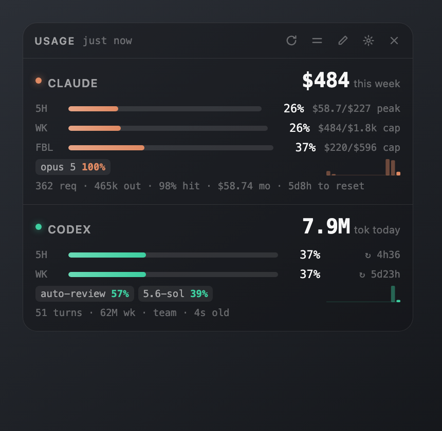
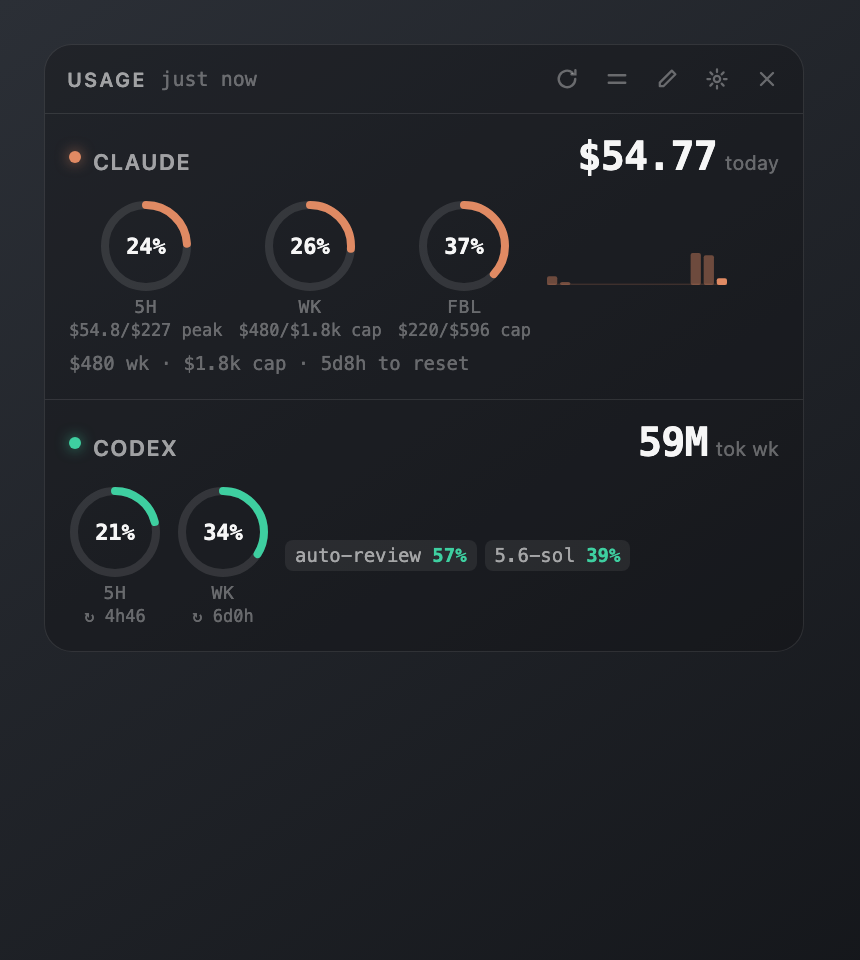

# usage-hud

A floating always-on-top panel for macOS showing what Claude Code and Codex are
costing you and how much of each quota window is gone.



It is a native `NSPanel` (borderless, real `NSVisualEffectView` vibrancy) hosting
a `WKWebView`, plus a dependency-free Node collector that reads the two CLIs'
own local logs and asks Anthropic's usage endpoint for the real Claude percentages
with the login Claude Code already holds. No Electron, no npm install, no API
keys; besides that request, the only network call is a once-a-day download of a
public model price list, and both can be turned off. Nothing else leaves the
Mac: no account, no telemetry, no server anywhere.

Every component in the panel is declared in a config file and rearrangeable from
inside the panel itself — see [Customizing](#customizing). Installing it is one
command: see [Set it up yourself](#set-it-up-yourself).

## What it shows, and how much to trust it

| Figure | Source | Accuracy |
| --- | --- | --- |
| Claude cost (today / week / month) | token counts in `~/.claude/projects/**/*.jsonl` priced at published Anthropic rates | computed, exact to the pricing table |
| Claude 5h / weekly / Fable gauges | the API's own percentage, fetched every two minutes with the Claude Code login (or cached by `/usage`), plus the spend measured since | **real** while that reading's window is open; otherwise cost against a cap (`cap` / `auto`) or your own record (`peak`) |
| Claude "limit reached" banner | the `quotaLimits` record Claude Code writes on a 429 | real, and only shown while the reset is still in the future |
| Codex 5h / weekly gauges | `rate_limits` in `~/.codex/sessions/**/*.jsonl` | **real** — Codex logs the server's own percentages |
| Codex tokens | `total_token_usage` deltas from the same events | computed, exact |
| Codex cost (daily / weekly / monthly) | token usage priced automatically at published standard model rates, including cached-input discounts | estimated API value; separate from your subscription bill |

### Where the Claude percentages come from

Claude Code keeps no running quota figure on disk, so the collector asks the API
directly: one `GET https://api.anthropic.com/api/oauth/usage`, the same call
Claude Code's `/usage` makes, authenticated with the OAuth token Claude Code
already stores on this machine (the `Claude Code-credentials` keychain item on
macOS, `~/.claude/.credentials.json` elsewhere). At most one request every
`claude.liveUsageSeconds` (default 120). The token is read, sent to Anthropic, and
never stored or logged. The first time, macOS asks whether `security` may read
that keychain item - click *Always Allow*. If the token has expired the panel says
so and waits; Claude Code refreshes it the next time you use it.

Set `claude.liveUsage: false` to turn the fetch off. The panel also reads the
response `/usage` caches in `~/.claude.json` (`cachedUsageUtilization`) and uses
whichever of the two readings is newer, so with the fetch off it tracks your
manual `/usage` runs.

Each gauge is anchored to the latest reading for as long as that reading's window
is still open:

    gauge = percentage the API reported + spend measured since it was read ÷ cap

The `↻` note on a gauge means it is anchored this way, and shows the time to that
window's reset. The panel measures your spend exactly, so between readings the
gauge drifts by exactly what you have used, and the next reading corrects any
goalpost move - a plan change, a promotional boost, a counter re-based. A banner
appears when the fetch is failing (offline, login expired) or, with the fetch off,
once a reading is over a day old.

When no reading applies to a window (the 5-hour block has rolled over, the week
has reset, or `/usage` has never been run) the gauge falls back to spend against a
cap, and the note says which cap:

- `cap` - one you configured, see below.
- `auto` - derived from the last applicable reading: the spend measured up to that
  moment divided by the percentage it reported. Kept in the cache and refreshed by
  every reading.
- `peak` - no cap at all: the heaviest comparable window in the last 30 days. That
  is a different claim - "busy compared to your own record", not "this much quota
  left" - and can be off by a wide margin.

Configured caps come from calibration, which no longer needs numbers typed in:

```sh
node collect.mjs --calibrate                                 # from the latest reading
node collect.mjs --calibrate weekly=26 fable=37 session=12   # or percentages read off /usage by hand
```

Both divide the spend measured in each window by the percentage and write the
resulting caps into `~/.config/usage-hud/config.json`. A configured cap wins over
an `auto` one, so re-run it after a plan change or when a promotional boost expires.

Three things the model gets right that a naive rolling window does not:

- **The weekly limit is a fixed window**, not a rolling seven days. It resets on a
  schedule, and spend from before that reset does not count against you. The reset
  time comes from the `/usage` reading when there is one, otherwise from
  `resetWeekday` / `resetHour` in the config.
- **Fable has its own weekly bucket**, separate from the all-models one, so it gets
  its own gauge.
- **The session limit is a 5-hour block, not a rolling window.** A block starts
  with your first request after the previous one expired and ends five hours later.
  The panel chains blocks forward from the last block end it knows about (from
  `/usage` or from a 429), so the 5h figure is the spend in the block open right
  now and its reset matches the app's "resets in". With no anchor at all it falls
  back to a rolling five hours. Requests from another machine or from the Claude
  app share the quota but are invisible here, so a block can start earlier than
  the panel thinks; the next reading re-anchors it.

Codex percentages are a snapshot from the last time Codex actually ran. While the
window is still open the number is current; once `resets_at` has passed the panel
shows `window reset` rather than a stale reading, and a banner appears if the
snapshot is over six hours old.

### Why this disagrees with Claude Code's own Stats page

`/stats` reports substantially larger token counts — for one 7-day window it showed
1.3b cache-read tokens where this tool measured 630m. The tool is not missing data;
both cover the same 16 sessions across every project.

Claude Code writes **one transcript line per content block** of a single assistant
response: a `thinking` line, a `text` line, a `tool_use` line. All of them carry the
same `message.id`, the same `requestId`, and the same *cumulative* usage object. In
one 3-day sample, 1542 of 2119 request ids appeared 2-6 times, every group shared a
single `message.id`, every group sat inside one file, and 1516 of them had a
byte-identical usage object.

An API response has exactly one `message.id`, and is billed once. Summing every line
therefore counts a single request two or three times over. `/stats` is a
line-oriented activity summary — it sits next to "your tokens are ~13x Anna
Karenina" — not a billing figure. This tool charges each `message.id` once.

## Set it up yourself

Everything runs on your own Mac from this repository. There is no account, no
server and nothing to pay for: the panel reads the logs Claude Code and Codex
already write under your home folder and shows what they add up to.

### What you need

- macOS 13 or newer, Apple silicon or Intel.
- Xcode Command Line Tools, for `swiftc`: `xcode-select --install`.
- Node 18 or newer on your `PATH` (Homebrew, nvm, anything).
- Claude Code and/or the Codex CLI, logged in and used at least once, so there
  are logs to read. One of the two is enough; the other card stays empty.

### Install

```sh
git clone https://github.com/r33hAB/usage-hud.git
cd usage-hud
./install.sh
```

That is the one command to run. It builds the app, copies it to
`~/Applications/UsageHUD.app`, writes a user LaunchAgent at
`~/Library/LaunchAgents/com.r33hab.usage-hud.plist`, and starts it. The panel then
comes back on its own after a restart. `./install.sh --uninstall` reverses all of
it and leaves your config and cache alone.

### First run

1. The panel appears in the top right corner of your main display. Drag it
   anywhere; the position is remembered.
2. macOS asks whether `security` may read the `Claude Code-credentials`
   keychain item. Click *Always Allow*. That is the login Claude Code already
   holds, and the panel uses it for one thing: asking Anthropic for your real
   quota percentages ([details](#where-the-claude-percentages-come-from)).
   Deny it and the panel falls back to the `/usage` reading Claude Code caches
   and to estimates against a cap; `"claude": { "liveUsage": false }` in the
   config turns the request off for good.
3. The first refresh reads every log on disk, which takes a moment on a big
   history; after that a refresh takes tens of milliseconds.
4. Right-click the panel for the menu: edit layout, appearance, saved configs,
   launch at login, ghost mode, quit. ⌥⌘U hides and shows it from anywhere.

### Update

```sh
git pull
./install.sh
```

### Where it keeps things

| What | Where |
| --- | --- |
| Config: layout, appearance, limits, hotkeys | `~/.config/usage-hud/config.json` |
| Config history and saved layouts | `~/.config/usage-hud/history/`, `~/.config/usage-hud/saved/` |
| Parsed-log cache, last 45 days | `~/.cache/usage-hud/cache.json` |
| Usage history, per-day totals kept for good | `~/.local/share/usage-hud/usage-history.json` |
| The app and its login item | `~/Applications/UsageHUD.app`, `~/Library/LaunchAgents/com.r33hab.usage-hud.plist` |

All of it is about your own usage and none of it leaves the Mac. Network
traffic is exactly two things, both optional: the quota request above and a
once-a-day download of a public model price list (`pricingFeed`, `null` to
turn it off). `./install.sh --uninstall` plus deleting those paths removes
every trace.

### Building without installing

`./build.sh` alone refreshes `build/UsageHUD.app` without touching the
installed copy or the login item, which is what you want while iterating on
the code. The build records the absolute path of your `node` into the bundle,
because a launched `.app` gets a minimal `PATH` and would never find an nvm
install otherwise, which is exactly the situation launchd starts it in.

Launch at login is also a toggle in the panel's right-click menu, so you can turn it off
without the terminal. It uses a plain LaunchAgent rather than `SMAppService`
because this app is ad-hoc signed and lives wherever you put it, which
`SMAppService.mainApp` does not reliably accept. `KeepAlive` is off, so Quit
means quit until the next login.

Only one instance runs at a time; a second launch exits immediately rather than
stacking a duplicate panel.

## Controls

The panel has no title bar. Drag it from anywhere except a control.

| Where | Action |
| --- | --- |
| ⟳ | refresh now |
| ☰ | minimise: keep the gauge bars only (the drawer's `minimised` setting chooses what stays) |
| ✎ | edit layout |
| ☀ | appearance drawer |
| ✕ | hide — the toggle hotkey (⌥⌘U) or opening the app again brings it back |
| right-click | show/hide, refresh, edit layout, appearance, open config, ghost mode, float above full screen, reset position, menu bar icon, quit |

There is no menu bar icon by default. **Show Menu Bar Icon** in the right-click
menu adds one with the same menu, carrying the two headline gauges
(`C 26% · X 37%`) so the numbers stay visible when the panel is hidden.
Opening the app while it is already running shows the panel and turns ghost
mode off, which is the way back if both hotkeys are taken.

### Hotkeys

System-wide, and they work whether or not the panel is visible:

| Shortcut | Action |
| --- | --- |
| ⌥⌘U | show / hide the panel |
| ⌥⌘G | ghost mode (click-through) on / off |

Ghost mode lets the mouse pass straight through the panel, for parking it over a
window you still need to use — which also means you cannot click the panel to turn
it back off, so it always keeps a keyboard way out.

Rebind them in the config:

```json
"hotkeys": { "toggle": "cmd+alt+u", "ghost": "cmd+alt+g" }
```

Modifiers are `cmd`, `alt` (or `opt`), `ctrl`, `shift`, joined to one key with `+`;
at least one modifier is required. Keys are `a`-`z`, `0`-`9`, `f1`-`f12`, `space`,
`escape`, `return`, `tab`, `grave`, and the arrows. `null` disables one. If another
app already owns a combo, registration fails and the menu item says `unavailable`
next to it — pick a different one.

These use Carbon's `RegisterEventHotKey`, which is the only route to a system-wide
shortcut that needs no Accessibility permission and actually consumes the
keystroke; `NSEvent` global monitors require Input Monitoring and cannot.

## History

Week by week and month by month live in the panel itself, without adding
anything to the layout. Open them with the bar-chart button in the title bar,
**Usage History…** in the right-click menu, or a click on any big number,
sparkline or history list, which opens the history on that value: a click on
"cost · last month" opens Claude cost by month. A drag that starts on one of
them still moves the panel. Escape, the ‹ button or the bar-chart button again
goes back.

- The top row picks the provider, the quantity (any of them: cost, tokens,
  requests, cache hit rate...) and **Weeks** or **Months**.
- Under it: this week (or month) so far, last week, and the average of the
  complete ones before, then how this one is pacing: the change on last week at
  the same point, and **on track for**, which is this week so far plus what the
  earlier weeks went on to add from the same point, on average.
- **Bars** draws one bar per week or month, with the average as a dashed line
  and the rest of the current one, if it goes the way the earlier ones did, as a
  dashed outline.
- **Overlay** lays the weeks over each other as running totals, Monday to
  Sunday (or by day of the month): this week, last week, every earlier week
  faintly, and their average dashed. Point at a day to read every line at the
  end of it.
- The list gives every week or month newest first, with its change on the one
  before. Hovering a bar, a row or a day names it in the line over the chart.

Weeks run Monday to Sunday and are numbered the ISO way (W41). Everything comes
from the [usage history](#usage-history); a week or month that began before it
is a lower bound (**+**) and is left out of averages and comparisons. The view
remembers its last choices.

## Customizing

Press ✎ (or **Edit Layout…** from the right-click menu) to open a dedicated customization view.
Its size stays steady while you edit, and it fits the current display. Long
layouts and settings scroll inside the window; **Done** and the section tabs
remain visible. A live preview stays beside the controls (above them on narrow
screens), updating immediately as you edit. Wide HUDs scale to fit the preview;
long previews scroll independently. **Minimised** in the preview lets you inspect
the compact view without changing your saved HUD state.

- **Layout** shows a compact list grouped by card. Select a component to see
  its labeled settings below the list. Drag its grip to reorder it, or use
  **Move up / Move down**. **Hide** keeps a component for later; **Remove**
  deletes it. **+ component** adds to a card, and **+ Add inside** adds to a
  side-by-side row or header. Each card also has an accent color, order, and
  visibility control.
- **Appearance** covers theme, density, minimised mode, HUD width, opacity,
  corner radius, vibrancy, and refresh interval. Changing HUD width keeps the
  editor steady; the chosen width applies to the HUD after **Done**.
- **Saved** keeps the current layout, appearance and refresh interval under a
  name you choose, and lists what you've saved with **Load** and **Delete**.
  Saving under an existing name (matched regardless of case) replaces it.
  A load is an ordinary edit, so **Undo last change** brings back what you
  had, and it never changes calibrated caps, hotkeys or pricing.
  The right-click menu's **Saved Configs** switches between them
  without opening the editor. Each lives in its own file under
  `~/.config/usage-hud/saved/`, apart from the config history, so undo and
  the 20-version limit never remove one.

Changes save automatically to `~/.config/usage-hud/config.json`.
**Undo last change** reverses recent edits, including removing a component.
**Done** or Escape returns to the HUD and restores its previous minimised state.
The right-click menu's **Undo Config Change** also restores archived config versions.

Every usage figure is a **quantity** shown over a **window**, and the same
windows are offered for every quantity. The **Value** picker lists the
quantities (cost, tokens, requests, cache hit rate, and so on) and the **Time
period** picker beside it lists the windows:

| Component | Windows |
| --- | --- |
| big number, stat line value, model chips | **Daily** (since local midnight), **Weekly** (since Monday), **Monthly** (since the 1st), **Last week** (the previous Monday to Sunday), **Last month** (the previous calendar month), **5h block** / **5h window**, **Quota week**, **Last 7 days** |
| sparkline | **Daily** (one bar per hour), **Weekly**, **Monthly**, **Last 7 days**, **Last 14 days** (one bar per day), **Last 12 weeks** (one bar per week), **Last 12 months** (one bar per month) |
| history list (**month by month** / **week by week** in the + menu) | one line per calendar month or per week (**Per**), newest first: 3, 6 or 12 of them. A week is named by its Monday; hover for its ISO week number and dates |

For the whole run of weeks or months, with the overlay, open [History](#history).
**Last week**, **Last month**, **Last 12 weeks**, **Last 12 months** and the
history list come from the [usage history](#usage-history), so they reach back
further than the 45 days the cache keeps. A week or month that began before the
history did shows its total with a **+**: it is a lower bound, and the hover
text says why.

The quota windows are the providers' own: for Claude the current 5-hour block
and the current weekly quota window, the same windows the gauges track; for
Codex the last five hours and the last seven days, the lengths of its two quota
windows. Changing the quantity keeps the window, changing the window keeps the
quantity, and each number in a stat line has its own pair of pickers. Gauges and
reset countdowns always follow the provider's quota windows; plan names and
status readings have no window.

Layouts saved before the windows were unified keep working: their old ids
(`claude.cost.weekly`, `codex.tokens.week`, `claude.models.wk`,
`claude.daily.cost` and friends) are aliases of the same entries and show up in
the editor as the window they always were.

Codex cost works automatically for models in the bundled published-price table
(verified 2026-09-23 against the [OpenAI pricing page](https://developers.openai.com/api/docs/pricing)
and its linked model pages). This is an estimate at standard API rates; it excludes
fast-mode, long-context and regional surcharges. Reasoning tokens are already
included in output, and cached input is charged only once at its discounted rate.
An internal or unknown model such as `codex-auto-review` has no price assigned:
mixed totals show **+** and **partial**, with the missing models listed on hover.
If all usage is unpriced, the value shows **—**, not $0. A model newer than the
bundled table is priced automatically from the daily price feed (see
[Pricing table](#pricing-table)) as soon as the feed lists it.

### Minimised

☰ minimises the panel, and `theme.collapsedMode` decides what that leaves:

| Mode | Keeps |
| --- | --- |
| `bars` (default) | the gauges, and nothing else. The title strip fades to the buttons and comes back on hover |
| `headers` | card names and their headline numbers |
| `both` | the two together |

A limit actually being hit shows through in every mode; a warning that a reading
has gone stale waits until you open the panel again, so it cannot camp over the
bars.

Editing by hand works just as well; the panel reloads within two seconds of the
file changing. `node collect.mjs --default-config` prints the shipped layout as a
starting point.

### Components

| Type | Options | Notes |
| --- | --- | --- |
| `header` | `title`, `items` | the card's name row; `items` sit right-aligned in it |
| `headline` | `metric`, `sub` | the big number. `sub: null` follows the metric's own caption |
| `meter` | `gauge`, `style: bar\|ring`, `label`, `size` | rings work well side by side inside a `row` |
| `chips` | `source`, `limit` | model shares over any window; Claude weighted by cost, Codex by tokens |
| `spark` | `series`, `width` | activity over any chart span, most recent on the right |
| `months` | `source`, `count` | one line per calendar month with a bar against the biggest; `source` is `<provider>.<quantity>` (`claude.cost`, `codex.tokens`) |
| `stat` | `metrics: [...]` | dim one-liner, values joined with `·` |
| `banner` | `source` | shows itself only when there is something to say |
| `row` | `items` | lays its children out side by side; straightened into a stack while editing |
| `text` | `value` | a static label |
| `divider` | — | a hairline |

`metric`, `gauge`, `series` and `source` names come from registries at the top of
`ui/hud.html`. `METRICS`, `SERIES` and `CHIPSOURCES` are generated from three
small tables: the quantities per provider (`QUANTITIES`), the windows a value can
cover (`WINDOWS`) and the spans a chart can draw (`SPANS`), so an id is always
`<provider>.<quantity>.<window>` (`claude.cost.month`, `codex.tokens.quotaWeek`,
`claude.activity.reqs.7d`). Adding a quantity or a window to a table gives it to
every picker at once. `MONTHLY`, behind the month list, is generated from
`QUANTITIES` too. Readings without a window (plan, reset countdowns, idle
time, scan time) are listed in `STATUS`; `GAUGES` and `BANNERS` are hand-written.



### Config

`~/.config/usage-hud/config.json`. Everything is optional; omitted keys fall back
to the defaults, and a supplied `cards` array replaces the default layout wholesale.

```json
{
  "refreshSeconds": 60,
  "pricingFeed": "https://raw.githubusercontent.com/BerriAI/litellm/main/model_prices_and_context_window.json",
  "theme": {
    "scheme": "auto", "density": "normal", "width": 380,
    "opacity": 1, "radius": 14, "vibrancy": "hudWindow",
    "collapsed": false, "collapsedMode": "bars"
  },
  "claude": {
    "limits": {
      "resetWeekday": 0, "resetHour": 20, "sessionHours": 5,
      "sessionUsd": null, "weeklyUsd": null, "weeklyFableUsd": null
    }
  },
  "codex": { "inputPerMTok": null, "cachedInputPerMTok": null, "outputPerMTok": null },
  "hotkeys": { "toggle": "cmd+alt+u", "ghost": "cmd+alt+g" },
  "cards": [ ... ]
}
```

- `theme.collapsedMode` — `bars`, `headers` or `both`; what ☰ leaves on screen.
- `theme.vibrancy` — any of `hudWindow`, `popover`, `sidebar`, `menu`, `toolTip`,
  `underWindowBackground`, `fullScreenUI`, `contentBackground`, `windowBackground`.
- `claude.limits.resetWeekday` — 0 is Sunday, local time.
- `hotkeys.*` — see [Hotkeys](#hotkeys). Changes apply without a restart.
- `pricingFeed` — URL of the daily price list; `null` disables the download and
  prices from the bundled tables alone.
- `codex.*PerMTok` — leave `null` for automatic published model prices. Setting
  input and output rates overrides all model prices; optional `cachedInputPerMTok`
  supplies a separate cached-input rate (otherwise the custom input rate applies).
  Choose **estimated API cost** in the editor to display dollars in any period.

### If a layout edit goes wrong

Every write archives the previous config to `~/.config/usage-hud/history/`
(newest 20 kept). **Undo Config Change** in the right-click menu walks back one
version per invocation, and **Show Config History** opens the folder. A layout is
hand-made work, so it is worth being able to get back.

## How it works

```
collect.mjs  →  one JSON blob on stdout (data + merged config)
     ↑                    ↓
 ~/.claude, ~/.codex   main.swift (timer)  →  window.hudUpdate(data)  →  ui/hud.html
                            ↑                                                ↓
                  ~/.config/usage-hud/config.json  ←──── saveConfig ─────────┘
```

`collect.mjs` is incremental. It keeps a cache at
`~/.cache/usage-hud/cache.json` holding, per log file, the byte offset it last
read to plus the usage records it found. A refresh re-parses only the bytes
appended since — a full cold scan of ~450 MB of logs takes about half a second,
a warm refresh about 40 ms. That cache is also the ledger the weekly and monthly
figures are built from: records from a log the CLI has since deleted are kept
(Claude Code prunes transcripts after its `cleanupPeriodDays`), and records
older than 45 days are dropped, which is long enough for the current calendar
month.

### Usage history

Past weeks and months outlive the cache in `~/.local/share/usage-hud/usage-history.json`.
It holds each local day's token totals and request count per model and
provider: no prompts, no paths, under 200 bytes a day. Every refresh writes the
days the ledger holds, and a stored day is only replaced by a reading of it with
at least as many requests, so records ageing out of the cache, a transcript
Claude Code prunes or a deleted cache can never shrink a month. Tokens are kept
rather than dollars, so months are priced with the current tables (and the
price feed) like every other figure.

The first refresh that finds no history file builds one from every log still on
disk, not only the 45 days in the cache, and records from when each provider's
history is complete (`since`). Codex keeps its session logs, so its history
starts with the oldest one. Claude Code deletes transcripts after its
`cleanupPeriodDays` (30 by default), so older Claude logs on disk are only the
sessions that happened to survive: Claude counts from that cut-off, or from the
oldest record a warm cache kept beyond it. Weeks and months that began before
`since` are shown as lower bounds.

An unreadable history file is renamed to `usage-history.json.unreadable-<time>`
and a new one started; a file written by a newer collector is left alone.
`--no-cache` runs read the history but never write it.

Two details worth knowing if you touch the collector:

- Lines are byte-filtered for `"usage"` / `"token_count"` before `JSON.parse`,
  which is what keeps the scan cheap; the vast majority of log lines are
  irrelevant.
- Claude requests are de-duplicated by `message.id`, keeping the largest usage
  snapshot per id: Claude Code writes one line per content block of a response,
  and forking a session copies earlier lines into a new file.

Useful invocations:

```sh
node collect.mjs --pretty                    # everything the panel has to work with
node collect.mjs --no-cache --pretty         # ignore the cache, full rescan
node collect.mjs --default-config            # the shipped layout, as JSON
node collect.mjs --calibrate                 # turn the latest quota reading into caps
node preview.mjs                             # build/preview-*.html with live data
node preview.mjs --sample                    # offline previews with sample data
node test.mjs                                # drive the editor in headless Chrome
```

`test.mjs` is the regression test for the editor — the only part of this tool that
can destroy work you typed in. It performs synthetic drags (within a card, between
cards, into the header zone, into a side-by-side row, emptying a card entirely),
the ↑ ↓ moves, a delete and an add, and asserts that the spec count changes by
exactly the right amount each time. It also checks screen-height limits, independent scrolling, selected-component
settings, undo, appearance refresh protection, and return to minimised mode.
Tests use deterministic sample data and an isolated temporary Chrome profile.

`preview.mjs` renders the UI with live data as plain HTML — normal, light,
collapsed, edit mode, drawer open, and an alternative ring layout. It is the
fastest way to iterate on `ui/hud.html` without rebuilding the app.

## Pricing table

In `collect.mjs`, USD per million tokens, first-party Anthropic rates (verified
2026-09-23 against the [Claude pricing page](https://platform.claude.com/docs/en/about-claude/pricing)).
Cache reads are billed at 0.1× input unless the model's entry carries its own
multiplier (Fable 5.1 and Mythos 5.1 read at 0.025×, Opus 5.5 at 0.05×), 5-minute
cache writes at 1.25×, 1-hour writes at 2×, and the transcripts record the TTL
split so both are priced correctly. Opus requests flagged `speed: "fast"` are
priced at the fast-mode premium, with the same cache multipliers on top. Update
the table when rates change.

New models and price changes are picked up from [LiteLLM's community price
list](https://github.com/BerriAI/litellm/blob/main/model_prices_and_context_window.json),
the one ccusage uses, fetched at most once a day (config `pricingFeed`; `null` turns
it off). The bundled table stays authoritative: the feed only prices models the
table has no entry for, and when it disagrees with a bundled price the Claude or
Codex alert banner says **published price changed for …** so the table can be
checked against the official page and updated by hand. A failed download keeps the
last good list and retries after an hour; the banner mentions it only once the list
is three days old.

Without either, a point release inherits its family's rate (a `claude-sonnet-5-1`
would price as `claude-sonnet-5`), an id the table has never seen is priced by
family name, and anything else falls back to Opus-tier pricing rather than zero,
so a new model shows up as expensive rather than free. The banner names any model
priced this way (**no published price for …**). One known gap: requests above the 200K
context threshold are priced at standard rates rather than long-context rates.

Cost is only a proxy for how Anthropic weighs a request against your limit, and
the weighting moves without notice - one day's calibration read 28% where the app
said 5% the next morning. That is why the gauges anchor to `/usage` readings and
treat the dollar caps as the fallback.

## License

MIT. See [LICENSE](LICENSE).
